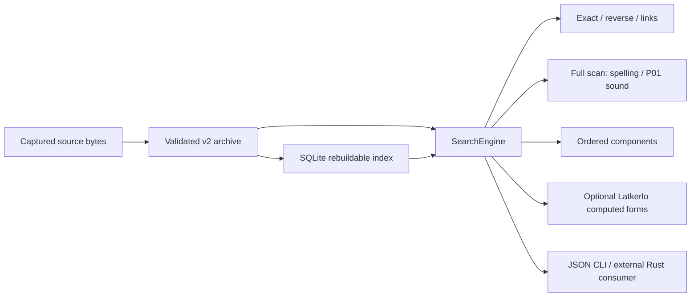
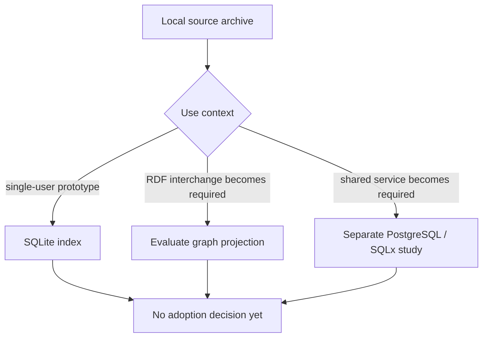

# Composed lexical search findings (Arc02 Slice04)

This report is the current endpoint for Arc02's local search prototype. It summarizes the accepted source-preserving model and SQLite comparison, then adds the reusable query library, JSON command-line interface, full-corpus sound/component scans, and optional morphology adapter. The prototype is a research result; library/content adoption, standards export, and service deployment remain open decisions.

## What the prototype does

`relojban-search` opens the accepted v2 archive-backed SQLite store and exposes typed queries with complete totals, deterministic bounded hits, corpus identity, source-native data, policy identifiers, and explicit exclusions. The JSON CLI is a separate `relojban-search` binary. Search does not collapse source records into one entry: exact `farvi` returns all 16 captured source records, while proposal records and computed morphology remain distinct result classes. Record IDs use the store's existing length-prefixed, byte-exact tuple encoding and can be hydrated through the documented public helper.

The current archive contains 21,241 records in 16 source snapshots, 17,181 distinct spellings, and is 28,320,417 bytes. Its source-class mapping is explicit and versioned: La rows use `word_type`, Lensisku rows use decoded `type_name`, and the two fixed LLG formats assert gismu/cmavo. Unknown native class strings stay on hits without a mapped kind; assigned-rafsi-only rows are not guessed into a word class. The independent full-population census found 21,241 records and these native classes: La has 40 bu-letterals, 599 cmavo, 620 cmavo compounds, 493 cmevla, 978 experimental cmavo, 388 experimental gismu, 4,082 fu'ivla, 1,342 gismu, 8,029 lujvo, 2 obsolete cmavo, 28 obsolete cmevla, 301 obsolete fu'ivla, 3 obsolete zei-lujvo, and 151 zei-lujvo; Lensisku has 4 fu'ivla and 109 gismu; LLG has 1,091 cmavo and 1,436 gismu. The earlier La-only mapping count is superseded; see the preserved prior and corrected population logs.

## Query families and observed results

The implementation and full-population comparison cover the six query families from the project contract. All result totals are computed before applying the requested hit limit; full-population reference sets are independently constructed from source records or direct public scan APIs, and native ID/edge sets are compared before any limit.

| Family | Current observed behavior | Boundary and limitation |
|---|---|---|
| Q01 exact spelling | Exact byte spelling `farvi`: 16 records. `si'e` remains separate from assigned `si'e → snime`; `sie` is a distinct exact query. The first captured form-role query returns one `SourceReportedForm`. `include_proposals=true` adds matching proposal rows to Exact results after source rows; the default remains source-only. | Source alternatives and languages remain separate. No punctuation stripping, normalization, source winner, or claim that bounded captures are exhaustive. Proposal IDs remain explicitly outside captured-source identity. |
| Q02 morphology | Ordered component query `farvi`: 10 exact source rows. Optional generation for `farvi + snime` returned computed `favysi'e` under Standard, score 7,987, component spans `[0,3]` and `[4,8]`. | Components use exact-label ordered subsequence with multiplicity; non-contiguous positions are allowed. Across the population, 8,156 fail the sequence and 13,075 are rejected by the pinned parser. Source assignments, parse output and generated candidates stay distinct; no etymology or semantic claim. |
| Q03 meaning/relation | Reverse definition substring `snow`: 25 records. Links from `farvi` at depth 2: 143 records and 365 edges. Definition contains `grow`, Brivla, at least two resolved nuclei: 15 records from 39 definition candidates. | Relation traversal uses explicit captured links. Empty results are valid. No prose-derived argument slots, inferred semantics, or invented relation. |
| Q04 sound | Two-syllable Brivla scan: 3,230 records; nuclei `[a,i]` Brivla scan: 462. | Uses unchanged P01 analysis and default canonical-unspecified policy. Population partitions include 15,607 requested-kind exclusions and 2,359 unmapped source-class rows, plus query-specific mismatch counts. Unresolved grouping is not treated as resolved syllable count. |
| Q05 similarity | Unicode-scalar Levenshtein distance ≤1 from `farvi`: 19 records across 2 distinct spellings. Aligned single-vowel contrast against Brivla: 2,768 records across 1,538 distinct spellings. | The spelling distance is a separate full scan with no prefilter on sound. Contrast uses P01 `DistanceModel.compare` per aligned single-vowel coordinate with profile/source explanations; no aggregate word score, diphthong metric, or perceptual claim. Contrast excludes 462 no-within-vowel mismatches and 45 unaligned/non-vowel cases, as well as kind/unmapped exclusions. |
| Q06 fidelity/interchange | Source-native classes and unknown strings are retained separately from explicit mapped kinds; a proposal-origin exact-`farvi` query returned 0 proposal records in the captured corpus. Responses expose source IDs, locators, policies, and per-native-stage candidate counts. The canonical archive retains missing/null/empty distinctions; `Hit` projects optional definition/gloss/notes values and does not itself encode those three presence states. | Native class is not UD POS. DMLex/OntoLex/ELEXIS findings below describe candidate mappings, not conformance. Proposal-origin rows, captured source rows and generated forms are distinct. Use source IDs/locators and canonical bytes where raw field-presence distinctions matter. |

The prior run `experiments/E03-lexical-data-search/slice04/probes/full-population-final-current.log` preserved census and totals but only checked membership in a 25-hit prefix for sound/component sets; it is retained as historical limited evidence. The current refinement run is `experiments/E03-lexical-data-search/slice04/probes/full-population-iteration02.jsonl`: it independently compares every returned ID in deterministic order, exact cardinality/no duplicates, distinct spellings and exclusions for complete result sets, then verifies limit-zero and seven-hit projections. It yields 3,230 two-syllable records / 1,779 spellings, 462 nuclei records / 241 spellings, 2,768 contrast records / 1,538 spellings, 10 ordered-component records, and 15 composed records. It also performs separate public Exact/Form membership joins for every input and generated spelling under all three generation settings, including reversed inputs; direct `get_lujvo_with_analytics` outputs and scores are compared, and the score API is named in each computed result. The corrected API returns totals and exclusion reasons even when the displayed list is limited. Empty results are successful results with their reason/count fields, not silent query failure.

The standalone consumer compiled and ran outside the workspace against the public API. With morphology disabled it opened the same full store, reported 21,241 records and exact-farvi total 16, and received typed `FeatureDisabled` for generation. With the optional feature enabled it returned one computed form. CLI integration controls cover help/version, JSON input and `--query`, limit zero, info, malformed/unknown operations and kinds, invalid limits/arguments, non-ASCII inputs, missing/invalid stores, and refusal to overwrite a fresh existing path. Output is JSON on stdout; errors are contextual on stderr with nonzero status; broken pipe exits cleanly.

## Architecture options

The local archive is authoritative. SQLite is a rebuildable local index; P01 and spelling/component scans operate on the source-preserving records; morphology is an optional computed adapter. The prototype does not persist computed results or make a hosted-service decision.

The accepted Slice03 same-record comparison supports SQLite as this prototype's default for its bounded measured 61-query workload: at the recorded Rust1.98.0 release configuration, SQLite's median batch was 4,203 ms versus Oxigraph's 15,478 ms; post-close directories were 194,306,048 and 194,474,716 bytes respectively. These results do not isolate engine causality, measure memory, or predict other workloads. See the full [Slice03 comparison](lexical-storage-comparison.md). A graph-native index remains an option if RDF/SPARQL interoperability or query requirements justify its storage/latency tradeoff. A shared PostgreSQL/SQLx service is only an inspected integration option; it was not implemented, loaded, or deployed. Keep the local archive and deterministic reindex path whichever index is later selected.

## Standards and reuse boundaries

The prior Slice01 reconnaissance remains controlling for service and standards claims in [the service/standards report](lexical-data-search.md). DMLex Core describes a monolingual resource, so `langCode=jbo` with English definitions is not Core-conformant; its Crosslingual module offers translation-language members and `headwordExplanation`, but at most one such explanation per language per sense does not directly preserve competing definitions as one sense. No DMLex conformance is claimed. OntoLex-Lemon is a W3C Community Group vocabulary, not a W3C Standard; it does not authorize inferred etymology, semantics, or realized components. ELEXIS reference code's pinned build failed with 26 compiler errors; runtime probes remain not run. The pinned jbotci dictionary crate is a credible reusable importer/search baseline with multi-row parsing, rafsi standing, and a reusable place parser, but its query named “exact” normalizes spelling; S02 found raw-presence/provenance limitations. No full download of jbotci's claimed 33,526-row Lensisku export was attempted; the separate La corpus was downloaded in the earlier slice. These results are recorded in [the model/import report](lexical-model-import.md).

The native class map here is project-specific evidence, not a Universal Dependencies mapping. Free controlled tags do not turn selma'o/native morphology into UD POS. Source code dependency notices and dictionary-content terms are separate; this work makes no content-license or reuse decision. The `farvi` source/prose place counts conflict (four versus five) and remain unresolved. Computed morphology is not a source assertion; this prototype uses Latkerlo only for parsing/generation and does not duplicate jbotci's place parser.

| Component or representation | Status and use boundary |
|---|---|
| `strsim` 0.11.1 | Used for Unicode-scalar Levenshtein spelling distance; package source and MIT notice were inspected. This does not define a sound/perceptual score. |
| Latkerlo `latkerlo-jvotci` 2.10.2601 | Optional component parsing and computed generation only. Adapter validates panic-prone inputs; outputs are not source attestations. |
| jbotci dictionary crate | Credible future import/search baseline with multi-row parsing, explicit rafsi standing and place segmentation. Normalizing query behavior and import fidelity gaps remain; no current dependency or full export ingestion. |
| SQLite / Oxigraph | SQLite is this prototype's bounded default; Oxigraph is a graph alternative supported by the accepted finite S03 comparison. Neither result is a universal engine decision. |
| DMLex / OntoLex / ELEXIS | Candidate interchange vocabulary/protocol work only, with documented mapping gaps and ELEXIS build/runtime limits. No export or conformance claim. |
| Code and content terms | Dependency notices and source-code licenses are evidence about code packages only. Dictionary-content reuse remains a separate unresolved decision. |

## Replay and evidence

Rust 1.98.0 is the declared minimum and the observed toolchain for final workspace gates and the external consumer. Run `experiments/E03-lexical-data-search/slice04/README.md` for the frozen input identities, commands, preserved attempts, and probe inventory. The archive and SQLite database used for the full-population proof stayed in `/tmp/relojban-s04-corpus.8BWjzJ/`; neither database nor Cargo target output is committed.

The candidate passed workspace format, check, test, Clippy with warnings denied, and rustdoc with warnings denied under default and all features; the CLI rustdoc target was documented separately in its own target directory after Cargo's shared binary/library output-path collision. The search crate's no-default-feature tests and Clippy also passed, including typed-disabled morphology behavior. External consumer and CLI checks passed. CC's delegated closing report marks six Slice04 rows proposed-done; the canonical planning ledger and later independent gate record the authoritative acceptance status. Arc02/project closure is not claimed.
