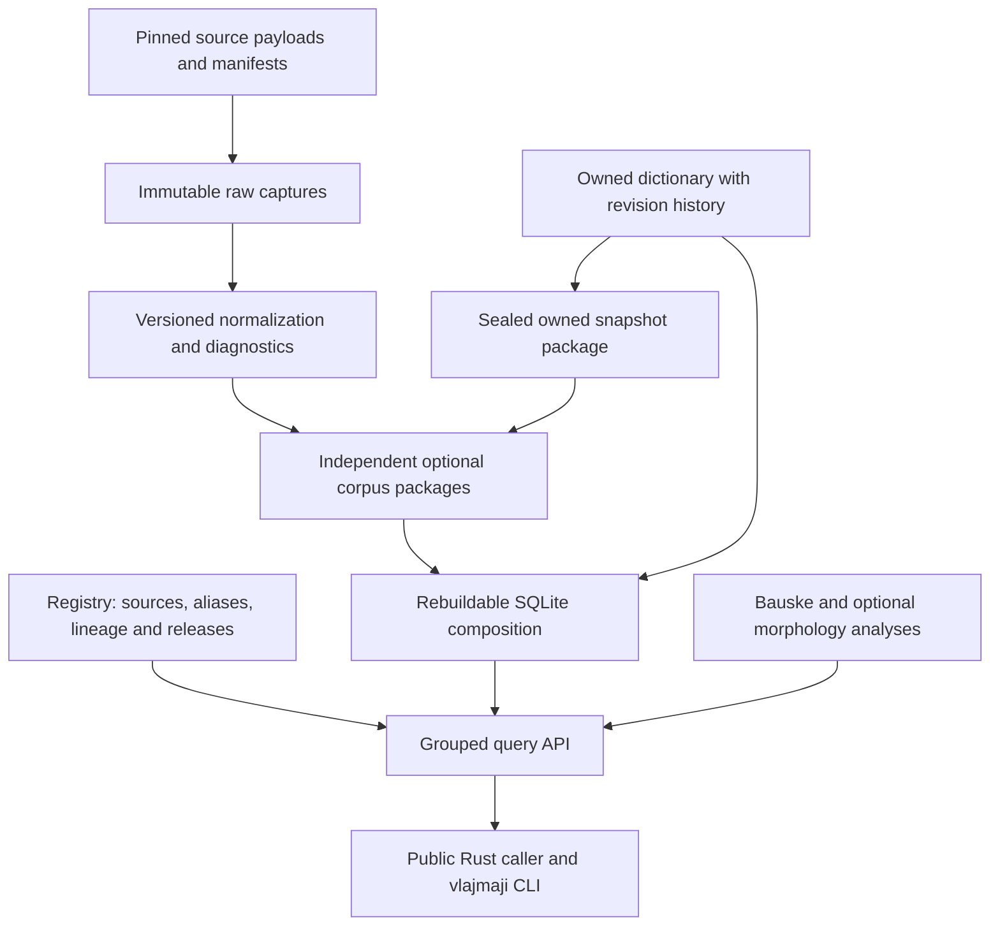

# Design — A dictionary of attributable assertions

**Status:** A01/A02 and bounded CLI/startup follow-ups accepted historically; Arc03 all4children and fresh technical composition accepted at source7b1c565, actual canonical packet independently accepted2026-10-25 (0.3.0 development, five original plus four optional data crates under crates/*). Current package/seal/composition design is [Arc03 plan](arc03-independent-corpus-packages/arc-plan.md) and its S01 plan. Physical multi-corpus topology remains A04, now execution-authorized through Arc04; S01 inquiry limits explicitly approved and concrete initial assignment issued, no result claimed. Original substrate observations below are historical at4ee3bab, not current claims. Current authority/readiness is [Arc04](arc04-composed-sqlite-lookup/arc-plan.md), its [S01 plan](arc04-composed-sqlite-lookup/slice01-topology-comparison/slice-plan.md) and [approved protocol](arc04-composed-sqlite-lookup/artifacts/topology-comparison-protocol.md); directive03 remains historical accepted Arc03 authority.

## Current substrate and the gap

The current code was inspected at Vlajmaji `4ee3bab`. `SourceMetadata`,
`SnapshotIdentity`, `RecordIdentity`, `FieldPresence`, forms, explicit references
and proposals already preserve useful distinctions. `Lexicon::import_source`
validates before mutation and treats the same namespace/hash as idempotent;
`lookup_exact` is byte exact. `vlajmaji-store::record_id` encodes the existing
length-prefixed identity tuple and must not be repurposed as a new source ID.

`crates/store/src/sqlite.rs` currently uses schema version 1 with archive, records,
forms, fields, edges and proposal tables. Its record indexes are useful, but are
not the requested dictionary registry, cross-source assertion model, release
catalogue or owned revision store. `crates/search` already composes six query
families; the CLI is `crate/cli`, binary `vlajmaji`. The workspace is on 0.2.0;
0.1.0 is the published PoC. Bauske resolves through the sibling path dependency.
These are inspected source facts, not a fresh runtime acceptance run.

## Logical layers

Crate responsibility stays with the existing libraries: lexicon owns source/model
contracts; store owns persistence and migration/rebuild; search owns queries and
labelled computation; CLI owns commands/rendering. Optional data crates depend on
shared contracts, and core model crates must not depend back on their datasets.
Data packages expose the assimilated normalized model before SQLite; a caller
must be able to consume it without opening a database. Exact serialization,
streaming representation and the feature-host API are A03 decisions grounded in
actual pack size and public-consumer needs, not a compulsory database dependency.

## Identity is a set of distinct relationships

- **Contributor** identifies an author/editor when known; absence stays unknown.
- **Source** identifies the asserting dictionary or collection authority. Its
  stable ID differs from its name, abbreviation, website and distributor.
- **Lineage** records evidence-backed derivation between sources/distributions.
  It neither erases observations nor invents independent corroboration.
- **Collection/component** describes a delivered corpus family and its parts.
  LLG roots, cmavo and rafsi remain separately identifiable components.
- **Snapshot** names immutable received bytes and their exact hash/provenance.
- **Normalized release** binds inputs, schema and normalizer versions, diagnostics
  and content terms. A package version is not a linguistic-source identity.
- **Upstream entry/assertion identity**, when supplied, differs from an immutable
  **occurrence locator**. Repeated rows remain separately addressable. Where no
  upstream identity exists, do not manufacture one from definition-text equality.
- **Owned revision** and **computed annotation** have separate editor/tool/input
  provenance. Neither can overwrite an upstream assertion.

Keep old snapshot/record identities addressable via an explicit adapter. A stable
catalogue may resolve references across pack removal/reinstallation; an absent or
changed release yields unavailable/unresolved state, not silent retargeting.
Cross-release continuity needs source IDs or an explicit reviewed mapping.

## Schema coverage contract

A01 S02 must account for every area below through concrete tables/types and a
raw-preserving extension policy. Later arcs populate or edit the model; they do
not excuse omitting these areas from the foundation contract.

| Area | Fidelity requirement |
| --- | --- |
| Registry | Stable source/contributor/distributor IDs; names and aliases; alias collisions and retirement history; source lineage with evidence/unknowns. |
| Collections/releases | Component, capture, upstream/distributor revisions, timestamp precision, raw bytes/hash/locator, schema/normalizer versions, counts and notices. |
| Entry/form | Source entry key, byte-exact spelling, language/script, supplied variants/pronunciations, native word class and selma'o separate from mapped POS. |
| Definition/assertion | Every occurrence and alternative, optional native IDs/senses, language, markup, contributor, source scores and dates. No invented sense per definition to fit interchange. |
| Gloss/context | Definition, gloss, notes, labels, register/domain, examples, translations and citations kept distinct; absent/null/empty and unknown JSON fields/types retained. |
| Arguments | Supplied structured frames/slots separate from prose and any computed place parsing. Preserve farvi's conflicting four/five-place witnesses. |
| Morphology | Assigned rafsi and their standing separate from source-reported forms, predictable stems, parsed components and generated candidates. Order and derivation provenance remain explicit. |
| Relations | Typed direction/scope and stable target refs with original citation/offset; unknown, unresolved and unavailable targets are distinct. No prose-inferred semantic equivalence. |
| Owned editing | Editor/revision history, immutable prior assertions, explicit tombstones and snapshot export; no destructive upstream replacement. |
| Editorial senses | Optional reviewed groupings/links with referenced assertions, editor/revision/rationale. Default lookup still shows all source assertions. |
| Computed material | Tool/version/run/input/policy and explanations separate from source attestation and aesthetic judgment. |
| Terms/interchange | Code/content notices separated; per-release redistribution status; DMLex/OntoLex mapping, unsupported/lossy fields and required extensions/sidecars. |

Pinned DMLex 1.0/OntoLex findings inform this table. DMLex Core's monolingual
restriction and Crosslingual per-language cardinalities must not flatten our
competing English explanations. OntoLex terminology does not require RDF storage.
ELEXIS is a later protocol option; its historical reference build failure is not
a claim about the protocol's usefulness or today's upstream implementation.

## Query contract

New grouped exact lookup returns **all** eligible matching occurrences by default,
under stable source IDs, display names and abbreviations, with contributor,
lineage/distributor, release and raw/native locators. Preserve the legacy query
surface via explicit adapters/versioning; do not silently change its `limit`
behavior while introducing this new all-definitions view.

Resolve aliases through the registry. Omitted source filters select all enabled,
available sources, including the owned source; explicit unknown, ambiguous,
disabled or unavailable selections produce typed errors. Availability metadata
also explains inactive packs. A valid no-match query succeeds with zero totals.

Report occurrence totals, distinct exact spellings, source-group count and
per-source totals **before** transport pagination. If upstream-identity or
independent-lineage counts are offered, label them separately. Duplicate raw
observations are not silently deduplicated into one result.

An optional positive page size pages assertion occurrences in stable source-ID,
spelling-byte and occurrence-ID order; groups disclose partial pages and full
totals. Size zero returns no occurrences but real totals. Concatenating all
positive-size pages must equal the complete ordered reference result exactly.
Bind cursors to schema/query/filter policies, active releases, owned revision and
last ordering key; reject malformed or stale cursors explicitly. A source/revision
change cannot silently skip, duplicate or retarget a result.

No local FTS rank is assumed comparable across files. Ranked search needs a
declared shared policy or explicit unsupported state. Existing exact, reverse,
explicit links, ordered components, sound filters and scalar spelling distance
retain their distinct semantics. Traditional phonetic encoders, spelling distance,
articulatory comparisons and poetic judgment must not be conflated.

## Full import and optional packages

A02 starts with the public jbotci-vendored raw `dictionary-en.json` plus metadata
at pin `3d9fd41d9ed32de26311ee27ec86b6b165985aa1`, identified by the preserved
planning receipt. Supplier metadata says 33,526 definition rows and 31,248 selected
embedded entries; those counts were not independently validated in that receipt.
Acquire the exact payload, verify hashes and reconcile observed counts rather
than forcing those values. The compiled `english()` projection chooses/reduces
records and is not the lossless import input.

Retain every row and field. Wiki/nonlexical, unknown-class and unsupported rows
remain in raw accounting with explicit query eligibility/diagnostics. The
normalized release accounts for every input occurrence and any emitted derived
objects. Parse failures and unsupported data never disappear into a success count.

Provide explicit **replay** (pinned local inputs), **check** (hash/schema/accounting
without rewriting a release) and **update** (deliberately acquire/pin a new release,
retain the old one). Use Bash/Make entrypoints where scripting is appropriate;
transformation belongs in reusable Rust. No ordinary build/load makes requests.
No scheduler or authenticated live service access is implied.

A03 includes all four named upstream families, not merely one demonstrator.
Candidate package names are `vlajmaji-data-lensisku-jbotci`, `vlajmaji-data-llg`,
`vlajmaji-data-la-lojban`, `vlajmaji-data-sutysisku`; A05 adds
`vlajmaji-data-owned`. These were proposed names at the original design checkpoint; all four now exist as internal publish=false crates after A03. The owned package remains A05.
If a collection is split into distinct corpora, each gets its own crate/feature.
Corpus lineage and overlap stay visible across combined selection.

## SQLite composition and the owned source

A04 compares one source-keyed derived database, sealed per-pack databases with
ATTACH, and application dispatch/fanout on identical source/query contracts.
Correctness comes first: complete IDs/multiplicities, links, totals/pages,
availability, schema mismatch and owned-revision consistency. Cost observations
must name their workload; historical SQLite/Oxigraph batch times are not exact
lookup latency or evidence choosing among these three designs.

Observe actual SQLite attachment/runtime limits. Readonly and immutable have
different meanings; use immutable only for genuinely sealed, never-changing
packfiles. Keep the owned store writable and locking-aware. Do not promise
cross-file crash atomicity under WAL; select a documented consistency strategy.
A03 crate independence does not select a physical file topology.

A05 provides explicit edits, append-preserving history/tombstones, reviewed
cross-source links and immutable export/reimport. The mutable working source is
not its optional sealed data package, and no edit suppresses another source's
assertion. Define conflict and revision behavior before issuing editor work.

## Integration and review

Each usable increment includes documentation, public-caller examples and meaningful
negative controls. Synthetic tests run normally; pinned corpus tests identify their
inputs and availability separately. Feature matrices cover no data, individual
packs, combined packs, morphology disabled/enabled, and affected graph compatibility
where relevant. Preserve existing experimental graph support rather than silently
breaking it while changing shared archive/model contracts.

Before issuing CC work, inspect the exact baseline and apply the framework's
prompt-authoring and relevant Rust guidance. This design is not an executable
assignment. Every slice needs independent disposition; arc/project composition
must demonstrate raw → normalized release → optional selection → SQLite lookup →
owned revision/export → Rust/CLI behavior. No public release is authorized here.

## Arc02 implementation boundary update —2026-10-24

The full pinned raw export was actually inspected:17,163,482B/33526rows, native word/word_type/definition_id keys differ from API captures. New explicit export adapter must preserve the existing legacyparser/archivecontract. Detailed current fieldmap/eligibility/API/metadata and two-slice delivery is [Arc02](arc02-reproducible-jbotci-import/arc-plan.md), with initial full normalization [S01](arc02-reproducible-jbotci-import/slice01-lossless-export-normalization/slice-plan.md). Historical current-substrate crate/cli,0.2.0/schema1-only statements are retained as provenance, superseded by acceptedA01 and inspectedcurrentbaseline. All12homes/terms/source distinctions remain. No A03package/topology/editor scope is activated.

## Arc02 delivered boundary —2026-10-24, technical composition complete

The preceding initial importer requirement is now delivered by S01at12fdd67 and S02at4e37016, with fresh independent technical composition:33526rawrows/278254orderedfields,33516eligibleoccurrences/31248spellings, exact2captures, full73226extensions and source/native history/terms. Public normalizedrelease works before SQLite; explicit pinned Bash/Make acquire/replay/check/update and fullfreshstore/drop/reopen/groupedRust+CLI/offlineoutside integration run. Exact finalcanonicalpacket accepted5456b54, Arc02CLOSED at4e37016. No inferred frame/sense/etymology/POS or source authority was added; unsupported/empty/wiki rows retain raw evidence with declared eligibility. Earlier receipt counts were expectations then, now independently reconciled. Cold release strictopen~25s/one-shotreleaseCLI25.619s(debug91.533s separately) remains P01-08/A04 and P01-11/12/A06 operational/API work, no selectedtopology/DDL/index/API redesign. A03alloptionalcollections,A04threecandidates,A05editor and A06fullprojectcomposition remain unactivated obligations; all14projectrowsOPEN.

## Arc03 delivered boundary —2026-10-25, CLOSED after independent technical/final acceptance

All4actual complete releases are explicitly materialized offline and compiled into optional data crates/umbrella features. Borrowed static release/seal bytes and strict load work independently before SQLite; consuming compose_dictionaries preserves identities and exact bodies, rejects unequal same-ID records, and keeps ordered maximum multiplicity for completely equal ExtensionRecords. Alias/lineage/capture/release differences cannot be collapsed into invented linguistic votes. SourceRegistry borrowed/consuming document access avoids whole-document clones in this composition. No public parser framework/new external dependency or schema/modelversion change.

Full assembled78361assertions/76803lexical/31375eligible words,566367native fields,3source groups retain every raw field/projection and explicit exclusions; La shares Lensisku authority, LLG source-assigned forms differ from Sut source-reported forms, unknown compact b/upstream remains opaque. All releases Held; software terms are not data grants. Actual packages are internal dependencies; real data excluded from Git/Cargo payloads, Synthetic CI prep is explicit and separate, default core offline/no data, selected absent payload compile error.

Fresh independent full store/create/drop/minimumreadonly reopen/verifyAll/nativeSQL/publicRust+releaseCLI integration accepted7b1c565; no A04 topology chosen or installeddefault changed. Ordinary minimal open does not establish full model validity or cheap/small queries. Current exact4pack farvi complete wire7160366B/5hits/3groups exposes payload/setup cost for later API/topology assessment; preserve all response metadata until an explicitly designed contract change. Historical strict-open timings above predate mergedPR3's explicit verification split and remain historical. Current query still loads typed data/setup indexes; no constant-time/subsecond/cold-disk claim. All14projectrowsOPEN, actual finalcanonical gate independently accepted at proposala5226ee.

## Arc04 planned workflow expansion —2026-10-25

Duncan's planning-only follow-up explicitly adds selected/all4local installation, catalogue/register/list/inspect, configured/default combined exact/reference lookup, lifecycle/recovery and readable+compact/full-detail outputs to A04's existing fair unified/ATTACH/fanout decision and selected integration. See [arc plan](arc04-composed-sqlite-lookup/arc-plan.md), [state/workflow contract](arc04-composed-sqlite-lookup/artifacts/user-workflows.md) and [proposed comparison](arc04-composed-sqlite-lookup/artifacts/topology-comparison-protocol.md). This is an additive planned delivery contract, not a chosen physical layout or source edit. Was: A04 named topology/availability integration without explicit installation/default/output journeys.

Registration, verified local installation, enablement and default/profile membership are separate catalogue states. Local enable/default policy does not rewrite immutable source ReleaseRecord.selected/history. “Install all” requires all four explicit local inputs/packs with no silent missing/Held skip; batch-provider/failure semantics must be decided before S02. Register-existing user-managed paths cannot be deleted by remove/unregister; tool-owned artifact deletion needs scoped ownership proof. A source/distributor/collection/release is not a physicalDB. Stage+verify before activation; failed installs/updates keep prior active generation, removed payload retains catalogue/reference history, exact reinstall recovers original IDs. Reader-generation binding, stale cursors and durable activation/recovery need topology-specific design before prompts; cross-file WAL does not establish atomicity. Existing explicitSTORE/legacy/fullJSON/minimal-open/explicitverify behavior stays compatible. Old/default migration is explicit/reversible in scratch; no actualuserdefault switch is authorized. Configuration follows sourceAGENTS confyg requirement if introduced.

Readable/compact output is a declared API/query projection before heavy hydration/serialization, not jq or full-response construction followed by deletion. Compact omits unrelated whole-release assertion inventories while preserving all matching occurrences, source/native/release/capture provenance, full totals/order/pages and stable detail/reference access with explicit presence states. Full mode remains. Resolve version/syntax/default behavior and numeric byte/latency/setup budgets before affected code/trials. Current7,160,366B fullfarvi capture and typeddecode/setup are evidence of a practical gap, not a preaccepted compact performance target.

A04 is PLANNED only. The finite proposed comparison needs separate Operator agreement before running; no code/store/benchmark/install/network/target action here. All14projectrowsOPEN. A05owns mutableowned editor/history/export, A06broaderQ01–Q06+owned finalintegration; A04must nevertheless deliver its own complete install→configuredlookup→lifecycle→output workflow. Arc01–03 accepted records and all protected stores remain unchanged.

## Arc04 renewal/readiness checkpoint —2026-10-25

GeneralAutonomousArc04 renewed after plan02c8063; currentS01specificinquiry/budget answer and concrete provider/trust/generation/ATTACH design remainHOLD. Isolatedcodexsource from7b created, no product/build/store/trial activity. Historicalplanning-only statements above remain datedhistory. Samefullresponse/setup policy must apply to independentlyloaded U/A/F topology prototypes; unifiedmetadata cannot supply A/Fcandidate results. All14projectrowsOPEN; A05/A06/publication/default gates unchanged.

## Arc04 S01 resolved provider design — 2026-10-25

The explicit Operator approval in protocol 1.2 supersedes the prior HOLD checkpoint. The issued S01 plan owns concrete closed snapshot APIs, typed-unverified composition, frozen generation/selection and read-only ATTACH limitations. Each topology loads its own full state and candidate IDs before common exact/reference/page policy; composition/hash/index setup and full hydration/serialization remain measured costs. Existing standalone full wire/cursor behavior stays compatible. No physical winner is presumed, no validated model is forged and no compact pass is claimed. All fourteen project rows remain OPEN; S05 output and A05/A06 owners unchanged.
