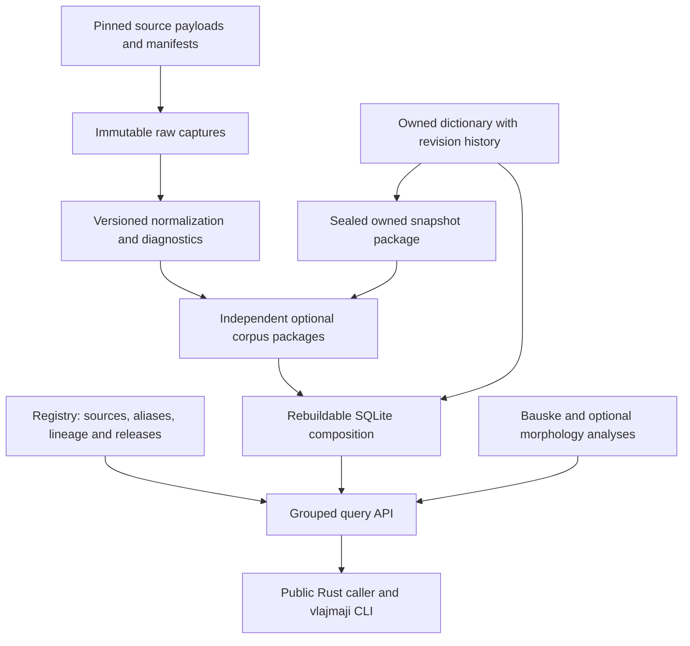

# Design — A dictionary of attributable assertions

**Current S05 technical proposal —2026-11-01:** source d8bd64e/tree d579 QUIET; actual31 unique independent calls (23zero/8typedone) PASS. Child8 close awaits ROOT canonical consistency; all8Arc/14project statuses remain OPEN, S06/S07 owners unchanged. Earlier dated metadata retains its as-of cutoff.

**Current S04 CLOSED —2026-11-01:** ROOT consistency837c0c5c accepted source04fead62/tree7a34a1b4 and authorised8 child status-only DONE transitions. All8 Arc06/all14 project raw rows remain unchanged OPEN; source/index/ONEtarget QUIET. S05 Links/S06 computed/S07 fresh assembled/newconsumer/identifiedFull/Operator retain owners. Following dated proposal clauses retain their as-of scope.

**Current S04 technical proposal —2026-11-01:** source04fead62/tree7a34a1b4 QUIET; independent31 (23zero/8typedone) PASS. S04 child close is pending ROOT canonical consistency; all8 Arc06/all14 project rows remain OPEN. Current S04 verifier governs exact grades; S05 Links/S06 computed/S07 fresh assembled+new consumer+Full/Operator remain. Earlier dated status/ownership paragraphs retain their as-of scope.

**CURRENT S03 CLOSED / ARC06 ACTIVE,2026-11-01.** ROOT canonical consistency PASS reviewed planning`09317990c184e5e732f784ba7379298821ea5630`/tree`99752e577d8d87c8c759e6bbf1318d3469921d95`, source`f47697edda910e7aa3a2076be800fb046fddb983`/tree`302627a2c8f572095b81af09b340c258ba4c9cdd`. This authorised mechanical close changes ONLY8 S03 Status OPEN→DONE, retaining every other raw ledger cell/Evidence; all8Arc/all14Project statuses remain OPEN. S01–03 are accepted locally; source/index/ONEtarget ROOT QUIET, CC parked. Reviewed Evidence/old proposal/pending clauses retain their09317990 cutoff and are superseded ONLY as current closure metadata by this dated receipt. Frozen methods/bindings/prompts/raws/CCoriginal/closedpriorchildren remain unchanged. Current seven-increment roadmap continues S04 reverse/form,S05 Links,S06 computed,S07 identified functional Full/new consumer/fresh assembled/SAME canonical/ROOT; S04 UNISSUED pending final readiness/intake/transfer. THROUGH ALL Arc06 remains active; no project acceptance/source/runtime/external/default/Full authority follows.

**CURRENT S03 VERIFIED / CANONICAL PROPOSAL,2026-11-01.** Source `f47697edda910e7aa3a2076be800fb046fddb983`/tree`302627a2c8f572095b81af09b340c258ba4c9cdd` is clean; correction02/5 is complete and source/index/ONEtarget ROOT QUIET. CDC's actual independent proof completed27 unique children (one author-compiled public example plus26 CLI),20zero/7expected typedone, across four launches WITHOUT replay; three observer errors and ROOT co-review misses are preserved. CDC proposes all8 S03 rows DONE pending ROOT canonical consistency and later exact mechanical transition; ALL8 S03/8Arc/14project statuses remain OPEN now. S01/S02 CLOSED; current seven-increment roadmap continues S04 reverse/form,S05 Links,S06 computed,S07 final. The current verifier/closing/retro and final proof govern this checkpoint; earlier CURRENT/pending/Evidence/ownership clauses remain historical at their dated cutoffs, including CC's unchanged original report. No further runtime/source authority, project acceptance or external delivery follows.

**CURRENT ARC06 / S03 INITIAL ACTIVE / SEVEN-INCREMENT CROSSWALK,2026-11-01.** Explicit de1eb1da transfer is effective: retained Luna/high CC exclusively owns issued S03 EXACT13 source paths/index/ONE target, ROOT/CDC readonly; source8f373fa0 is BASELINE, current authoring is WIP, not frozen/accepted. Early format/fmtcheck pass and compile-only lint failures are preserved; no S03 behavior/acceptance claimed. ROOT approved UNISSUED S04 ReverseDefinition+stored Form and S05 bounded Links; computed→S06/final→S07, with original lexical A06-03 requiring BOTH S04+S05. The exact current arc crosswalk supersedes earlier numeric roadmap labels at their dated cutoffs; all8arc/14project raw rows/statuses remain unchanged OPEN. S01/S02 CLOSED; five assignments/slice and THROUGH ALL Arc06/final NEW actual/SAME canonical/ROOT/separate Operator boundaries unchanged. No S03 packet/input/source scope or external/default/retainedFull/acquisition/performance authority changes.

**CURRENT S03 INTAKE ACCEPTED / TRANSFER READY,2026-11-01.** CDC accepted the complete issued-c27d1f1 readback after bounded required-null, all-retained-row/admission, native-policy and data-coverage clarifications; fresh clean source8f373fa0/tree8f0d/protectedrefs/guard/env/input pins PASS. AFTER the named checkpoint commit and explicit CDC message, retained Luna/high CC exclusively owns EXACT13 issued paths/index/ONE retained target for INITIAL/pass1 of5; ROOT/CDC then source/index/target READONLY. Until that message ROOT QUIET. All8 S03/all8arc/all14project remain OPEN; S01/S02 CLOSED. The earlier current/pending/ownership paragraphs retain their dated cutoffs and are superseded only by this current metadata. Through ALL Arc06 remains active; no external/default/retainedFull/acquisition/performance authority.

**CURRENT S02 CLOSED / ARC06 ACTIVE,2026-11-01.** ROOT canonical consistency PASS reviewed proposal `a831fa184dbbf62b1e5882c94e1c0aed2bfd5bd3`/tree`0dd8461a2852971480b042e6775c64ed7436855a`, source `8f373fa0298694b03d88f735a2ff11f1d1b9ca41`/tree`8f0d61298a061410c8a133df2107b73b4de4313e`. The authorised mechanical transition changes ONLY S02-01…08 Status OPEN→DONE, retaining every other raw table cell/Evidence. S01's8 child rows remain DONE; all8 Arc06/all14 project rows remain OPEN. Source/index/ONE retained target ROOT QUIET, CC parked. Actual independent33 is one author-compiled Rust example replay plus32 independently observed CLI children,28zero/5typedone; original author gates/private controls and inherited/platform limits retain their exact grades. Three confirmed unauthorised temporary-tool-home acquisitions and a fourth available attribution-unclassified formatter body remain explicit deviations. S03 is DRAFT/unissued pending complete final design/prompt/readset and ROOT readiness. Earlier proposal/pending/Evidence clauses retain their reviewed a831fa18 cutoff and are superseded ONLY as current closure metadata by this dated receipt; frozen method/bindings/raws/issued prompt/closed S01 records are unchanged. Through ALL Arc06 remains authorised; final references/query variants/functional Full/fresh assembled/SAME canonical/ROOT and separate Operator project gates remain.

**Historical metadata boundary:** following earlier status/ownership paragraphs retain their as-of cutoffs; the current acceptance/source/QUIET metadata above supersedes them.

**CURRENT HOLD,2026-10-31:** cf0998f0/tree18b66ea7 remains frozen/clean, native gates and original24-child independent proof retain their exact scopes. Late ONE std-only Rust1.98/edition2024 probe reproduced E0282 in the active nonUnix let-return/method shape (not a Windows crate build). The uncommitted close proposal was WITHDRAWN before acceptance commit and preserved under S01 artifacts/close-proposal-withdrawn01. All8 S01/all8arc/all14project OPEN. PASS2/5 iteration01 is DRAFT/unissued: ONE existing source path decode_native_path complete cfg return blocks, unchanged common/Unix behavior; exact positive language control/affected checks/normal builds then same24 independent proof are ROOT-dispositioned, but no source/index/target transfer yet. ROOT source/index/ONEtarget QUIET, CC parked. Earlier dated/status prose below retains its old cutoff.

**Current,2026-10-31:** Arc01–05 CLOSED; Arc05 actual PR7 delivered merged cb13d377/treec8a65825 with main CI41239808260 SUCCESS. Directive05 activates THROUGH Arc06; S01 INITIAL/pass1 implementation now CC-exclusive exact14/source-index/ONEtarget after root ae0d4b31 readiness and actual accepted complete intake/explicit transfer c1deac39. Root/CDC source/index/target readonly. All14 project rows OPEN; Operator project acceptance separate. Current concrete integration design is the Arc06 section below and its S01 plan; source authoring has begun, still uncompiled at this checkpoint; no behavior/build/Full/default/external action is claimed. The following older status paragraphs retain their dated cutoffs.

**Historical status, 2026-10-26 UTC (superseded by Arc05 header):** Arc01–03 accepted history remains below. A04 S01 selected Unified for the finite own-state/full-typed comparison; S02 local provisioning/catalogue is CLOSED atce1bd238 after independent technical/canonical acceptance and current Linux/macOS CI. Configuration/default selection, lifecycle and compact/readable projection remain S03–S05; A05 owned writable topology remains reserved. Current authority/readiness: [Arc04 plan](arc04-composed-sqlite-lookup/arc-plan.md), [S02 plan](arc04-composed-sqlite-lookup/slice02-local-provisioning-catalogue/slice-plan.md) and [approved comparison protocol](arc04-composed-sqlite-lookup/artifacts/topology-comparison-protocol.md). Actual user default is unchanged; no new language authority or source/DB equivalence is implied.

Historical pre-S02 current framing: **Status:** A01/A02 and bounded CLI/startup follow-ups accepted historically; Arc03 all4children and fresh technical composition accepted at source7b1c565, actual canonical packet independently accepted2026-10-25 (0.3.0 development, five original plus four optional data crates under crates/*). Current package/seal/composition design is [Arc03 plan](arc03-independent-corpus-packages/arc-plan.md) and its S01 plan. Physical multi-corpus topology remains A04, now execution-authorized through Arc04; S01 inquiry limits explicitly approved and concrete initial assignment issued, no result claimed. Original substrate observations below are historical at4ee3bab, not current claims. Current authority/readiness is [Arc04](arc04-composed-sqlite-lookup/arc-plan.md), its [S01 plan](arc04-composed-sqlite-lookup/slice01-topology-comparison/slice-plan.md) and [approved protocol](arc04-composed-sqlite-lookup/artifacts/topology-comparison-protocol.md); directive03 remains historical accepted Arc03 authority.

## Current substrate and the gap

The current code was inspected at Vlajmaji `4ee3bab`. `SourceMetadata`,
`SnapshotIdentity`, `RecordIdentity`, `FieldPresence`, forms, explicit references
and proposals already preserve useful distinctions. `Lexicon::import_source`
validates before mutation and treats the same namespace/hash as idempotent;
`lookup_exact` is byte exact. `vlajmaji-store::record_id` encodes the existing
length-prefixed identity tuple and must not be repurposed as a new source ID.

`crates/store/src/sqlite.rs` currently uses schema version 1 with archive, records,
forms, fields, edges and proposal tables. Its record indexes are useful, but are
not the requested dictionary registry, cross-source assertion model, release
catalogue or owned revision store. `crates/search` already composes six query
families; the CLI is `crate/cli`, binary `vlajmaji`. The workspace is on 0.2.0;
0.1.0 is the published PoC. Bauske resolves through the sibling path dependency.
These are inspected source facts, not a fresh runtime acceptance run.

## Logical layers

Crate responsibility stays with the existing libraries: lexicon owns source/model
contracts; store owns persistence and migration/rebuild; search owns queries and
labelled computation; CLI owns commands/rendering. Optional data crates depend on
shared contracts, and core model crates must not depend back on their datasets.
Data packages expose the assimilated normalized model before SQLite; a caller
must be able to consume it without opening a database. Exact serialization,
streaming representation and the feature-host API are A03 decisions grounded in
actual pack size and public-consumer needs, not a compulsory database dependency.

## Identity is a set of distinct relationships

- **Contributor** identifies an author/editor when known; absence stays unknown.
- **Source** identifies the asserting dictionary or collection authority. Its
  stable ID differs from its name, abbreviation, website and distributor.
- **Lineage** records evidence-backed derivation between sources/distributions.
  It neither erases observations nor invents independent corroboration.
- **Collection/component** describes a delivered corpus family and its parts.
  LLG roots, cmavo and rafsi remain separately identifiable components.
- **Snapshot** names immutable received bytes and their exact hash/provenance.
- **Normalized release** binds inputs, schema and normalizer versions, diagnostics
  and content terms. A package version is not a linguistic-source identity.
- **Upstream entry/assertion identity**, when supplied, differs from an immutable
  **occurrence locator**. Repeated rows remain separately addressable. Where no
  upstream identity exists, do not manufacture one from definition-text equality.
- **Owned revision** and **computed annotation** have separate editor/tool/input
  provenance. Neither can overwrite an upstream assertion.

Keep old snapshot/record identities addressable via an explicit adapter. A stable
catalogue may resolve references across pack removal/reinstallation; an absent or
changed release yields unavailable/unresolved state, not silent retargeting.
Cross-release continuity needs source IDs or an explicit reviewed mapping.

## Schema coverage contract

A01 S02 must account for every area below through concrete tables/types and a
raw-preserving extension policy. Later arcs populate or edit the model; they do
not excuse omitting these areas from the foundation contract.

| Area | Fidelity requirement |
| --- | --- |
| Registry | Stable source/contributor/distributor IDs; names and aliases; alias collisions and retirement history; source lineage with evidence/unknowns. |
| Collections/releases | Component, capture, upstream/distributor revisions, timestamp precision, raw bytes/hash/locator, schema/normalizer versions, counts and notices. |
| Entry/form | Source entry key, byte-exact spelling, language/script, supplied variants/pronunciations, native word class and selma'o separate from mapped POS. |
| Definition/assertion | Every occurrence and alternative, optional native IDs/senses, language, markup, contributor, source scores and dates. No invented sense per definition to fit interchange. |
| Gloss/context | Definition, gloss, notes, labels, register/domain, examples, translations and citations kept distinct; absent/null/empty and unknown JSON fields/types retained. |
| Arguments | Supplied structured frames/slots separate from prose and any computed place parsing. Preserve farvi's conflicting four/five-place witnesses. |
| Morphology | Assigned rafsi and their standing separate from source-reported forms, predictable stems, parsed components and generated candidates. Order and derivation provenance remain explicit. |
| Relations | Typed direction/scope and stable target refs with original citation/offset; unknown, unresolved and unavailable targets are distinct. No prose-inferred semantic equivalence. |
| Owned editing | Editor/revision history, immutable prior assertions, explicit tombstones and snapshot export; no destructive upstream replacement. |
| Editorial senses | Optional reviewed groupings/links with referenced assertions, editor/revision/rationale. Default lookup still shows all source assertions. |
| Computed material | Tool/version/run/input/policy and explanations separate from source attestation and aesthetic judgment. |
| Terms/interchange | Code/content notices separated; per-release redistribution status; DMLex/OntoLex mapping, unsupported/lossy fields and required extensions/sidecars. |

Pinned DMLex 1.0/OntoLex findings inform this table. DMLex Core's monolingual
restriction and Crosslingual per-language cardinalities must not flatten our
competing English explanations. OntoLex terminology does not require RDF storage.
ELEXIS is a later protocol option; its historical reference build failure is not
a claim about the protocol's usefulness or today's upstream implementation.

## Query contract

New grouped exact lookup returns **all** eligible matching occurrences by default,
under stable source IDs, display names and abbreviations, with contributor,
lineage/distributor, release and raw/native locators. Preserve the legacy query
surface via explicit adapters/versioning; do not silently change its `limit`
behavior while introducing this new all-definitions view.

Resolve aliases through the registry. Omitted source filters select all enabled,
available sources, including the owned source; explicit unknown, ambiguous,
disabled or unavailable selections produce typed errors. Availability metadata
also explains inactive packs. A valid no-match query succeeds with zero totals.

Report occurrence totals, distinct exact spellings, source-group count and
per-source totals **before** transport pagination. If upstream-identity or
independent-lineage counts are offered, label them separately. Duplicate raw
observations are not silently deduplicated into one result.

An optional positive page size pages assertion occurrences in stable source-ID,
spelling-byte and occurrence-ID order; groups disclose partial pages and full
totals. Size zero returns no occurrences but real totals. Concatenating all
positive-size pages must equal the complete ordered reference result exactly.
Bind cursors to schema/query/filter policies, active releases, owned revision and
last ordering key; reject malformed or stale cursors explicitly. A source/revision
change cannot silently skip, duplicate or retarget a result.

No local FTS rank is assumed comparable across files. Ranked search needs a
declared shared policy or explicit unsupported state. Existing exact, reverse,
explicit links, ordered components, sound filters and scalar spelling distance
retain their distinct semantics. Traditional phonetic encoders, spelling distance,
articulatory comparisons and poetic judgment must not be conflated.

## Full import and optional packages

A02 starts with the public jbotci-vendored raw `dictionary-en.json` plus metadata
at pin `3d9fd41d9ed32de26311ee27ec86b6b165985aa1`, identified by the preserved
planning receipt. Supplier metadata says 33,526 definition rows and 31,248 selected
embedded entries; those counts were not independently validated in that receipt.
Acquire the exact payload, verify hashes and reconcile observed counts rather
than forcing those values. The compiled `english()` projection chooses/reduces
records and is not the lossless import input.

Retain every row and field. Wiki/nonlexical, unknown-class and unsupported rows
remain in raw accounting with explicit query eligibility/diagnostics. The
normalized release accounts for every input occurrence and any emitted derived
objects. Parse failures and unsupported data never disappear into a success count.

Provide explicit **replay** (pinned local inputs), **check** (hash/schema/accounting
without rewriting a release) and **update** (deliberately acquire/pin a new release,
retain the old one). Use Bash/Make entrypoints where scripting is appropriate;
transformation belongs in reusable Rust. No ordinary build/load makes requests.
No scheduler or authenticated live service access is implied.

A03 includes all four named upstream families, not merely one demonstrator.
Candidate package names are `vlajmaji-data-lensisku-jbotci`, `vlajmaji-data-llg`,
`vlajmaji-data-la-lojban`, `vlajmaji-data-sutysisku`; A05 adds
`vlajmaji-data-owned`. These were proposed names at the original design checkpoint; all four now exist as internal publish=false crates after A03. The owned package remains A05.
If a collection is split into distinct corpora, each gets its own crate/feature.
Corpus lineage and overlap stay visible across combined selection.

## SQLite composition and the owned source

A04 compares one source-keyed derived database, sealed per-pack databases with
ATTACH, and application dispatch/fanout on identical source/query contracts.
Correctness comes first: complete IDs/multiplicities, links, totals/pages,
availability, schema mismatch and owned-revision consistency. Cost observations
must name their workload; historical SQLite/Oxigraph batch times are not exact
lookup latency or evidence choosing among these three designs.

Observe actual SQLite attachment/runtime limits. Readonly and immutable have
different meanings; use immutable only for genuinely sealed, never-changing
packfiles. Keep the owned store writable and locking-aware. Do not promise
cross-file crash atomicity under WAL; select a documented consistency strategy.
A03 crate independence does not select a physical file topology.

A05 provides explicit edits, append-preserving history/tombstones, reviewed
cross-source links and immutable export/reimport. The mutable working source is
not its optional sealed data package, and no edit suppresses another source's
assertion. Define conflict and revision behavior before issuing editor work.

## Integration and review

Each usable increment includes documentation, public-caller examples and meaningful
negative controls. Synthetic tests run normally; pinned corpus tests identify their
inputs and availability separately. Feature matrices cover no data, individual
packs, combined packs, morphology disabled/enabled, and affected graph compatibility
where relevant. Preserve existing experimental graph support rather than silently
breaking it while changing shared archive/model contracts.

Before issuing CC work, inspect the exact baseline and apply the framework's
prompt-authoring and relevant Rust guidance. This design is not an executable
assignment. Every slice needs independent disposition; arc/project composition
must demonstrate raw → normalized release → optional selection → SQLite lookup →
owned revision/export → Rust/CLI behavior. No public release is authorized here.

## Arc02 implementation boundary update —2026-10-24

The full pinned raw export was actually inspected:17,163,482B/33526rows, native word/word_type/definition_id keys differ from API captures. New explicit export adapter must preserve the existing legacyparser/archivecontract. Detailed current fieldmap/eligibility/API/metadata and two-slice delivery is [Arc02](arc02-reproducible-jbotci-import/arc-plan.md), with initial full normalization [S01](arc02-reproducible-jbotci-import/slice01-lossless-export-normalization/slice-plan.md). Historical current-substrate crate/cli,0.2.0/schema1-only statements are retained as provenance, superseded by acceptedA01 and inspectedcurrentbaseline. All12homes/terms/source distinctions remain. No A03package/topology/editor scope is activated.

## Arc02 delivered boundary —2026-10-24, technical composition complete

The preceding initial importer requirement is now delivered by S01at12fdd67 and S02at4e37016, with fresh independent technical composition:33526rawrows/278254orderedfields,33516eligibleoccurrences/31248spellings, exact2captures, full73226extensions and source/native history/terms. Public normalizedrelease works before SQLite; explicit pinned Bash/Make acquire/replay/check/update and fullfreshstore/drop/reopen/groupedRust+CLI/offlineoutside integration run. Exact finalcanonicalpacket accepted5456b54, Arc02CLOSED at4e37016. No inferred frame/sense/etymology/POS or source authority was added; unsupported/empty/wiki rows retain raw evidence with declared eligibility. Earlier receipt counts were expectations then, now independently reconciled. Cold release strictopen~25s/one-shotreleaseCLI25.619s(debug91.533s separately) remains P01-08/A04 and P01-11/12/A06 operational/API work, no selectedtopology/DDL/index/API redesign. A03alloptionalcollections,A04threecandidates,A05editor and A06fullprojectcomposition remain unactivated obligations; all14projectrowsOPEN.

## Arc03 delivered boundary —2026-10-25, CLOSED after independent technical/final acceptance

All4actual complete releases are explicitly materialized offline and compiled into optional data crates/umbrella features. Borrowed static release/seal bytes and strict load work independently before SQLite; consuming compose_dictionaries preserves identities and exact bodies, rejects unequal same-ID records, and keeps ordered maximum multiplicity for completely equal ExtensionRecords. Alias/lineage/capture/release differences cannot be collapsed into invented linguistic votes. SourceRegistry borrowed/consuming document access avoids whole-document clones in this composition. No public parser framework/new external dependency or schema/modelversion change.

Full assembled78361assertions/76803lexical/31375eligible words,566367native fields,3source groups retain every raw field/projection and explicit exclusions; La shares Lensisku authority, LLG source-assigned forms differ from Sut source-reported forms, unknown compact b/upstream remains opaque. All releases Held; software terms are not data grants. Actual packages are internal dependencies; real data excluded from Git/Cargo payloads, Synthetic CI prep is explicit and separate, default core offline/no data, selected absent payload compile error.

Fresh independent full store/create/drop/minimumreadonly reopen/verifyAll/nativeSQL/publicRust+releaseCLI integration accepted7b1c565; no A04 topology chosen or installeddefault changed. Ordinary minimal open does not establish full model validity or cheap/small queries. Current exact4pack farvi complete wire7160366B/5hits/3groups exposes payload/setup cost for later API/topology assessment; preserve all response metadata until an explicitly designed contract change. Historical strict-open timings above predate mergedPR3's explicit verification split and remain historical. Current query still loads typed data/setup indexes; no constant-time/subsecond/cold-disk claim. All14projectrowsOPEN, actual finalcanonical gate independently accepted at proposala5226ee.

## Arc04 planned workflow expansion —2026-10-25

Duncan's planning-only follow-up explicitly adds selected/all4local installation, catalogue/register/list/inspect, configured/default combined exact/reference lookup, lifecycle/recovery and readable+compact/full-detail outputs to A04's existing fair unified/ATTACH/fanout decision and selected integration. See [arc plan](arc04-composed-sqlite-lookup/arc-plan.md), [state/workflow contract](arc04-composed-sqlite-lookup/artifacts/user-workflows.md) and [proposed comparison](arc04-composed-sqlite-lookup/artifacts/topology-comparison-protocol.md). This is an additive planned delivery contract, not a chosen physical layout or source edit. Was: A04 named topology/availability integration without explicit installation/default/output journeys.

Registration, verified local installation, enablement and default/profile membership are separate catalogue states. Local enable/default policy does not rewrite immutable source ReleaseRecord.selected/history. “Install all” requires all four explicit local inputs/packs with no silent missing/Held skip; batch-provider/failure semantics must be decided before S02. Register-existing user-managed paths cannot be deleted by remove/unregister; tool-owned artifact deletion needs scoped ownership proof. A source/distributor/collection/release is not a physicalDB. Stage+verify before activation; failed installs/updates keep prior active generation, removed payload retains catalogue/reference history, exact reinstall recovers original IDs. Reader-generation binding, stale cursors and durable activation/recovery need topology-specific design before prompts; cross-file WAL does not establish atomicity. Existing explicitSTORE/legacy/fullJSON/minimal-open/explicitverify behavior stays compatible. Old/default migration is explicit/reversible in scratch; no actualuserdefault switch is authorized. Configuration follows sourceAGENTS confyg requirement if introduced.

Readable/compact output is a declared API/query projection before heavy hydration/serialization, not jq or full-response construction followed by deletion. Compact omits unrelated whole-release assertion inventories while preserving all matching occurrences, source/native/release/capture provenance, full totals/order/pages and stable detail/reference access with explicit presence states. Full mode remains. Resolve version/syntax/default behavior and numeric byte/latency/setup budgets before affected code/trials. Current7,160,366B fullfarvi capture and typeddecode/setup are evidence of a practical gap, not a preaccepted compact performance target.

A04 is PLANNED only. The finite proposed comparison needs separate Operator agreement before running; no code/store/benchmark/install/network/target action here. All14projectrowsOPEN. A05owns mutableowned editor/history/export, A06broaderQ01–Q06+owned finalintegration; A04must nevertheless deliver its own complete install→configuredlookup→lifecycle→output workflow. Arc01–03 accepted records and all protected stores remain unchanged.

## Arc04 renewal/readiness checkpoint —2026-10-25

GeneralAutonomousArc04 renewed after plan02c8063; currentS01specificinquiry/budget answer and concrete provider/trust/generation/ATTACH design remainHOLD. Isolatedcodexsource from7b created, no product/build/store/trial activity. Historicalplanning-only statements above remain datedhistory. Samefullresponse/setup policy must apply to independentlyloaded U/A/F topology prototypes; unifiedmetadata cannot supply A/Fcandidate results. All14projectrowsOPEN; A05/A06/publication/default gates unchanged.

## Arc04 S01 resolved provider design — 2026-10-25

The explicit Operator approval in protocol 1.2 supersedes the prior HOLD checkpoint. The issued S01 plan owns concrete closed snapshot APIs, typed-unverified composition, frozen generation/selection and read-only ATTACH limitations. Each topology loads its own full state and candidate IDs before common exact/reference/page policy; composition/hash/index setup and full hydration/serialization remain measured costs. Existing standalone full wire/cursor behavior stays compatible. No physical winner is presumed, no validated model is forged and no compact pass is claimed. All fourteen project rows remain OPEN; S05 output and A05/A06 owners unchanged.

Current execution constraint, 2026-10-25: protocol1.3 specifically HOLDS further S01 Full create/query/timing after a pre-create comparator prerequisite violation. Concrete provider design is unchanged; retained-two/finish-three exception requires explicit Operator response. No comparison result or topology selection exists.

The newer protocol1.4 recommendation is clean re-entry (retained two plus fresh five), not a bespoke resume. Count amendment remains an explicit Operator decision; no topology/data/API scope change.

## Current count amendment and unchanged design — 2026-10-25

Duncan explicitly approved seven TOTAL candidate stores: retain the two historical/unaccepted stores and create five clean comparison stores only after the remaining prerequisites. Protocol 1.5 records the exact answer and timestamp semantics. Same seven working hours including preparation, 12 GiB including the retained two, 600-second bounds and three balanced rounds; no reset. COUNT gate cleared only. Full operations remain HOLD until CDC reviews the complete comparator/prefix/source/gates, batch/reference/page and Value-serialization harness, frozen category config, binaries and expanded argv. No topology decision or acceptance is implied; all rows remain OPEN.

## Arc05 owned authority and context adapter — 2026-10-28

The authoritative working source is a new versioned owned SQLite journal, not a writable DictionaryStore or upstream catalogue. S01 takes complete validated Dictionary genesis/candidates: immutable ordered typed vectors append, current owned head/catalogue revision are explicit control changes, one new same-source revision carries editor/time/rationale/complete active IDs and explicit tombstones. BEGIN IMMEDIATE re-reads persisted head; two already-open handles stale edits conflict without LWW. All prior selected release flags and bodies remain immutable; existing owned-head intersection gates current assertions. Summary head/history do not secretly verify every historical model; explicit show and later export/check own full model/hash scope. Full S01 API/schema/rollback/input/example/gates are in its slice-plan; this design does not add a second competing API.

Cross-source curation uses a version1 OWNED external-catalogue context adapter/envelope, outside normalized Dictionary until actual exact context is supplied. Reuse typed CatalogTarget/direction and editorial editor/revision/rationale. Missing context remains unavailable/unresolved. To materialize, validate/compose actual immutable context bodies FIRST, then project reviewed relations/senses with real release/assertion closure. Unequal same-ID bodies reject. No foreign placeholder releases, implicit full-corpus copy per edit, spelling-inferred identity or silent retarget. Local reviewed senses remain supported. S02 must freeze the exact record/schema/status/error APIs before issue and prove persistence/reimport plus positive/negative Tiny reference behavior; the obligation belongs to Arc05, not Arc06.

S03 delivers distinct version1 owned sealed full-history snapshot/load/reimport, preserving source notices/raw/native/metadata/revision history and exact replay-vs-conflict policy. It returns existing Dictionary for pure composition and explicit fresh derived DictionaryStore creation/query. No new in-memory search constructor is assumed in S01. S04 adds optional default-empty publish=false data-owned crate/feature, not a fifth PackId or mandatory All input. Normalized model/archive/index versions and four upstream package/install semantics remain unchanged. Broader live mixed managed integration stays Arc06.

Physical checkout is reused on new owned branch from merged a55; ONE target, no Full/default/Bauske mutation. Data feature validation uses a disjoint Synthetic source/materialization archive so ignored Full payloads cannot be overwritten. No new latency claim or BL0001 work. Historical Arc04 accepted timing exceptions, failures and evidence stay intact.

## Arc06 explicit prepared mixed view —2026-10-31

[Directive05](cdc-directive05.md) and [Arc06 plan](arc06-integrated-dictionary-workbench/arc-plan.md) govern the final integrated workbench arc. First increment [S01](arc06-integrated-dictionary-workbench/slice01-bound-mixed-view/slice-plan.md) makes selected installed upstream models plus a live owned journal revision usable now through public Rust/CLI build-new, Exact/Resolve/Compact/Readable/detail. Store owns the rebuildable binding/build, search retains typed query engines, CLI native FILE/transport only. No in-place refresh/active pointer or silent CollectionProfiles v1 extension; S02 later freezes distinct versioned config/lifecycle. Four PackIds/All-four and optional owned package remain separate.

Owned schema1 is a base-only supported input, schema2 materializes the actual pinned sidecar. Same pinned reader captures selected identity/body then is explicitly dropped; fresh short readers observe identity around publication and before/after ordinary queries. Head view stales on append; historical r1 remains usable after later appends if its selected schema/base/curation identity and upstream binding remain unchanged. Explicit schema migration changes identity even at the same head. New cheap revision_identity reads checked summaries and recorded digests, not full models/history. Build verifies models/context/seals once; ordinary open/query reuses existing unverified typed setup/indexes and small identities, not whole-model clones/comprehensive audits. Source changes require explicit build-new into another destination; no cross-file atomicity/current-forever claim.

Curation bindings explicitly map pin IDs to ordered SELECTED enabled installed PackIds. Singleton uses the original loaded Dictionary directly (even singleton composition can dedup anonymous metadata); multi-pack uses declared compose order and the pin must match that actual input construction. No arbitrary context-file admission, generation-hash inference or pin rewrite. Omitted pin remains truthful unavailable/unresolved; bad selected binding fails before success. Missing original/installed input copies after a completed build are advisory if semantic dependency identities remain unchanged; ordinary queries do not reopen them. Complete persisted binding/authority/pin/record outcomes stay inspectable through info; per-query transport carries a SMALL cached summary of identities/mode/revision/counts, never every unrelated owned active ID or curation record. Readable exposes the same summary before existing matched-hit renderer.

S03/S04 extend the typed workbench route across ALL12 Query variants with original source/analysis/proposal policies, rather than invent a lossy owned-to-legacy archive. S05 owns identified pinned four-corpus/owned functional offline replay with fresh disjoint outputs, affected clean caller/features/package recipes, and full composition. Its finite input/method/root gate comes before actual Full work; missing inputs retain owners. No BL-0001 benchmark, source acquisition, actual defaults or accepted retained Full catalogue/DB/cache leaf probes. Frozen prior packets/metadata authorities and distinct software/content rights remain unchanged; final project Operator gate remains separate.

## Arc06 pre-issue reference/lifecycle split —2026-10-31

ROOT agrees configured lifecycle/CAS/status S02 and complete integrated-reference admission S03 are separate useful increments. Full typed ReferenceEntity and Compact descriptor are not interchangeable body witnesses; S03 freezes narrow retained-provider identity helpers, catalogue-only admission and existing per-format native/status rules without Full hydration in Compact or a hidden whole-descriptor startup audit. The original lexical/computed/offline duties now belong to S04/S05/S06 through the explicit arc crosswalk; previous dated labels remain historical. All capabilities/14 project obligations remain, no S01 source assignment/issued contract or runtime authority changes. Exact S02/S03 prompts and source sets remain unissued until accepted predecessor reconciliation and ROOT readiness.

## Current accepted S01 capability —2026-10-31

**CURRENT CDC LOCAL ACCEPTANCE / S01 CLOSED,2026-10-31; ROOT close consistency pending.** Final source `4fc937dcbebd0e2f3171f495345d6ab2a6e29f62`/tree`5faeb83f99a056683e0c444a8172f015674d8fbf`, parentcf0998; cumulative14 paths from cb13, corrective commit ONE decoder function only. S01 eight rows DONE after genuine PASS2 source/language/affected/default-build review and SAME24 independent point-of-use PASS. All8 Arc06/all14 project rows remain OPEN, including A06-01 final fresh assembled oracle. ROOT source/index/ONEtarget QUIET; S02 remains unissued pending complete final draft/readset/ROOT readiness. No external/default/Full operation or Windows build/runtime claim. Every earlier HOLD/INITIAL/ownership/source/pending clause below retains its dated historical cutoff and is superseded by this current metadata; original prompts, raw bodies and withdrawn proposal stay unchanged.

Bubble-up answers: (1) delivered useful explicit NEW-root mixed upstream+owned build/query/detail/history/context capability locally, with current compact identity/native binding and real point-of-use proof; no external delivery. (2) unexpected late dormant-platform inference, preflight newline/receipt and coauthor metadata findings were corrected/preserved transparently; no arc structural change beyond the already agreed lifecycle/reference split. (3) all8 original child obligations accounted, zero defer/no-op/silent drop; all8 arc/all14 project contracts/status/Notes stay OPEN. Remaining S02 lifecycle/S03 references/S04–05 lexical+computed variants/S06 functional identified Full+fresh assembled/SAME canonical/ROOT and separate Operator project acceptance remain.

## Current design checkpoint — S02 proposal,2026-11-01

The implemented configuration is a separate strict JSON family, preserving CollectionProfiles v1. Publication is guarded configuration rename plus independent immutable view construction; there is no joint SQLite/config transaction. Reusable queries bind exact config bytes and effective generation, with short pre/post dependency checks and cached format-specific engines. This instantiates the existing design; S03 still owns complete catalogue reference admission. ROOT canonical consistency remains pending.

## Arc06 lexical successor crosswalk —2026-11-01

ROOT-approved source-backed split: original first-roadmap lexical S03 now requires BOTH current S04 literal ReverseDefinition+stored Form and S05 bounded Links; original computed S04→currentS06, original offline/final S05→currentS07. See current Arc06 plan/table and unissued S04/S05 plans. Prior drafts/history remain in Git at7c429165/00368855; no Links/edge stubs in S04. Original8arc/all14project raw rows unchanged OPEN; current S03 issued packet/inputs/13-path INITIAL ownership unaffected. No runtime/source change or pass reset; throughALLArc06/final fresh+SAMEcanonical/ROOT/Operator and protected-data/external boundaries unchanged.

## S03 canonical checkpoint —2026-11-01 verified S03 proposal

Actual sourcef47697ed and final27 unique independent children are reconciled in S03 cdc-verification/closing/retro. Prior failure/source/ownership clauses retain their historical cutoff. Three observer repairs changed no product or expected semantic authority. ROOT canonical consistency and exact8 child flips are pending; all8child/8arc/14project statuses remain OPEN. Current seven-increment crosswalk and complete obligations unchanged. Source/index/ONEtarget QUIET; no new runtime or external authority.
